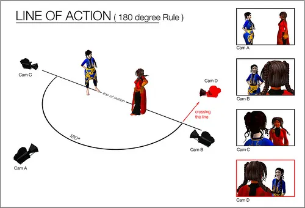

# 13 Oct - Film Direction

## The shots

### Extreme long shot (ELS) or extreme wide shot (EWS)

They make your subject appear small against their location, to make your subject look far away.

### Long shot (LS) or Wide shot (WS)

### Full Shot (FS)

Let the subject fill the frame while keeping emphasis on escenary.

### Medium wide shot (MWS)

### Cowboy shot (CS) or American shot

To frame a gunslinger´s gun or holster on his hip.

### Medium shot (MS)

One of the most common, similar to the cowboy, but frames from roughly the waist up and through the torso.

### Medium close up shot (MCU)

You can see shoulders and face but it still keeps the subject someway distant.

### Close up (CU)

You want to reveal subject´s emotions and reactions, the background disappear, the most important is the subject, near enough to register tiny emotions, but no so close that we lose visibility.

### Extreme close up (ECU) 

It often shows eyes, mouth, details, etc.

---

## Continuity - types

* Content
* Movement
* Position
* Time

* 180° Rule: Always keel the filming in an imaginary axis or eye line.

